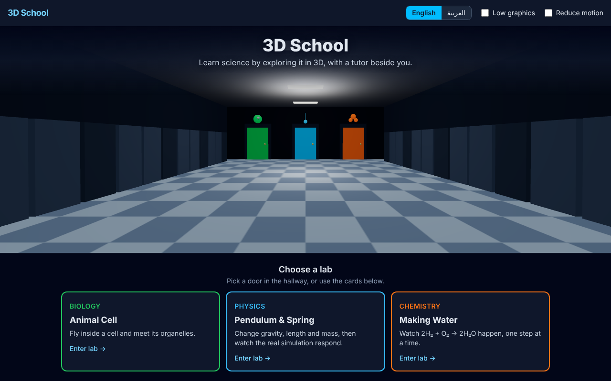
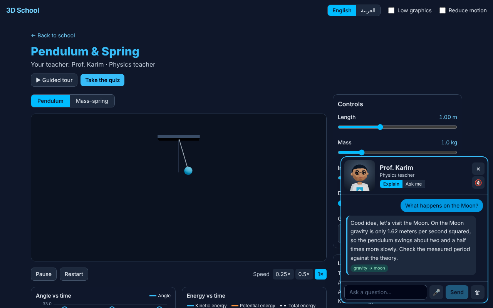
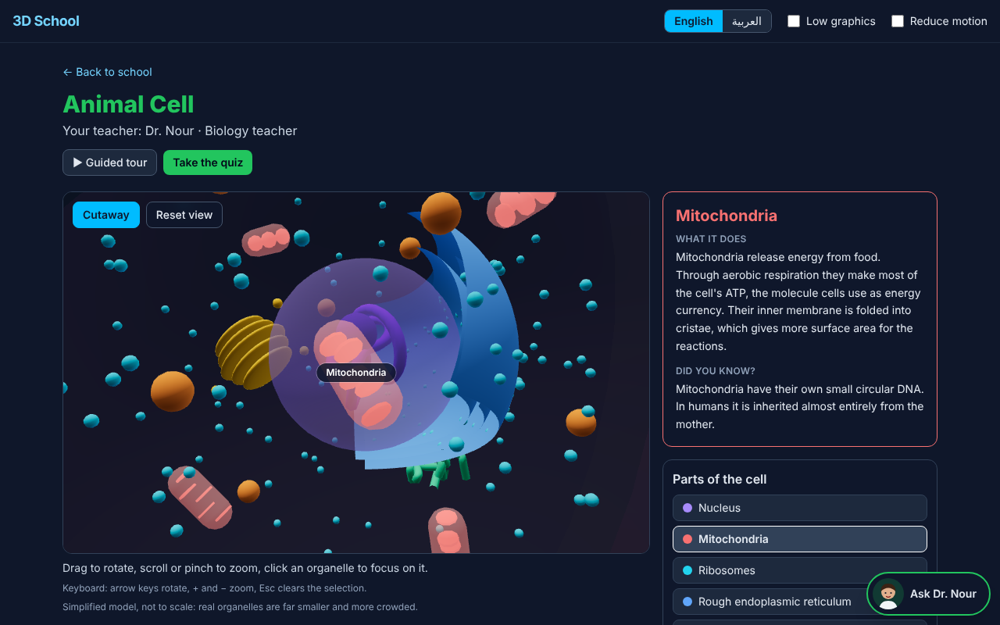
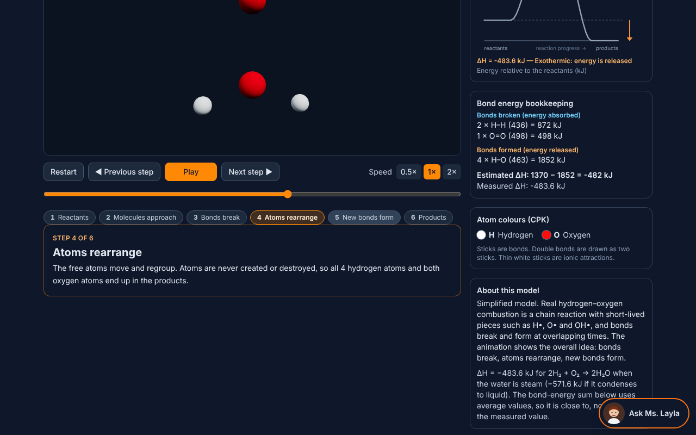
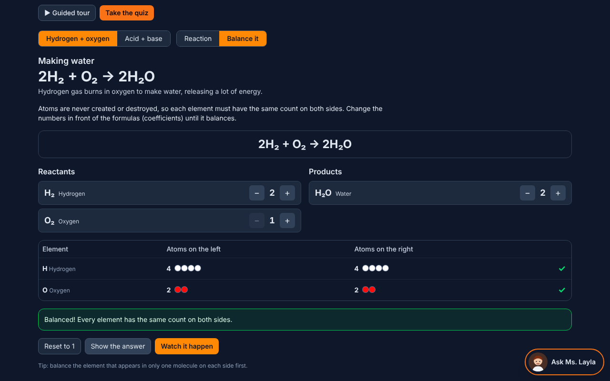
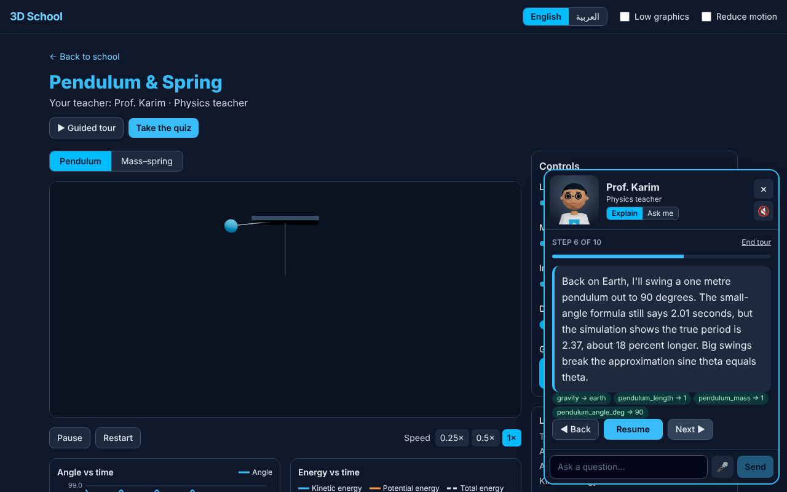
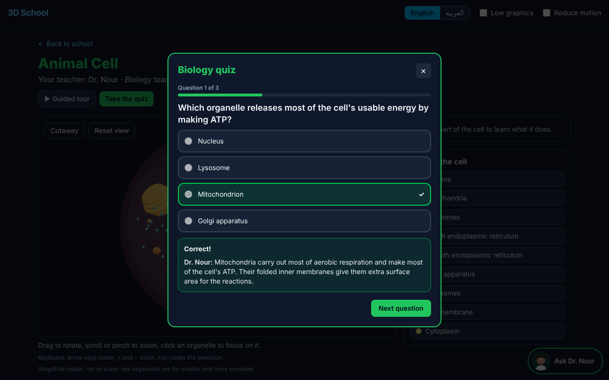
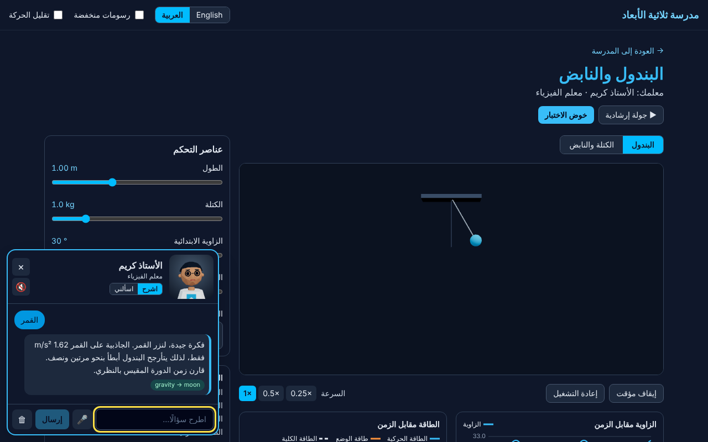
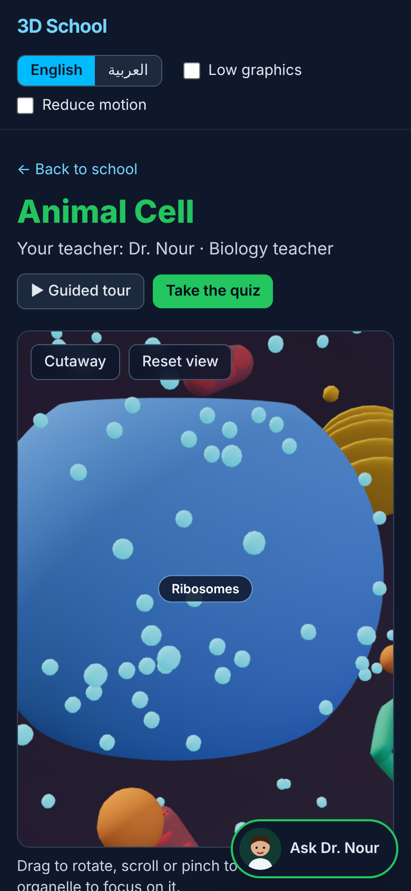
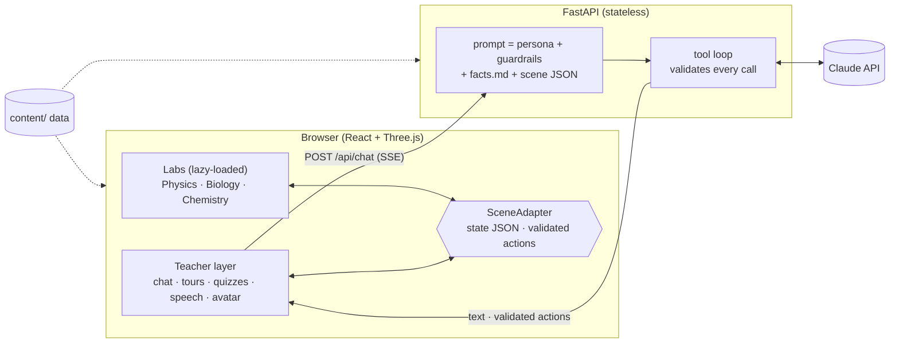

# 3D School

[](https://github.com/zoro6u/zoro6u-3d-school/actions/workflows/ci.yml)

**Learn Biology, Physics and Chemistry by exploring them in 3D, with an AI teacher beside you.**
Three interactive labs, three teacher characters who can *see* what you're doing and *operate* the simulation while they explain,
full English + Arabic (RTL) support, and a guided tour that works even with no API key and no internet.



> 🎬 **Demo GIF: placeholder.** To be recorded on a phone (`docs/demo.gif`).

## What's inside

| | Lab | Highlights |
|---|---|---|
| 🧬 | **Biology: Animal Cell** | Procedural 3D cell (nucleus, mitochondria, ribosomes, rough/smooth ER, Golgi, lysosomes, membrane, cytoplasm). Orbit/zoom, click to fly to an organelle, **cutaway** slice, info panel. No external models, so no licensing issues. |
| ⚛️ | **Physics: Pendulum + Mass–spring** | A *real* RK4 simulation (fixed timestep, full nonlinear pendulum, not an animation). Sliders, Earth/Moon/Mars, live charts of angle and kinetic/potential/total energy, **theoretical vs measured period**, and an explanation of when the small-angle approximation fails (at 90° it's ~18% off). |
| ⚗️ | **Chemistry: 2H₂ + O₂ → 2H₂O** | Ball-and-stick CPK molecules; bonds break, atoms rearrange, new bonds form, exothermic glow. Step-by-step mode, an interactive **balancing view**, and a bond-energy ledger (1370 − 1852 = −482 kJ vs measured −483.6). **Data-driven**: HCl + NaOH → NaCl + H₂O was added with data files only. |

**AI teachers**: Dr. Nour (biology), Prof. Karim (physics), Ms. Layla (chemistry): low-poly 3D characters with idle animation, blinking and a mouth that follows their voice.
- **Scene-aware**: every question carries the live scene as JSON (angle, selected organelle, reaction step…).
- **They operate the lab** through validated tool calls (`set_param`, `focus_object`, `play_reaction_step`, `reset_scene`): "show me the Moon" actually switches gravity.
- **Socratic mode** ("Ask me") guides with questions instead of lecturing.
- **Grounded**: each lesson's curated `facts.md` is injected as ground truth; science-only, age-appropriate, refuses off-topic requests, prompt-injection aware.
- **Short, spoken-style, streamed** replies with captions always on.
- **Offline fallback**: narrated **guided tours** (scene actions synced to narration), plus **3-question quizzes** and **saved progress**. All work with no key and no network.

<table>
<tr>
<td width="50%"><br><sub><b>Physics</b>: the teacher switches to the Moon preset; the green chip shows what it changed.</sub></td>
<td width="50%"><br><sub><b>Biology</b>: cutaway slice and a focused organelle.</sub></td>
</tr>
<tr>
<td><br><sub><b>Chemistry</b>: new O–H bonds form; the glow shows energy released.</sub></td>
<td><br><sub><b>Balancing view</b>: atom counts on both sides.</sub></td>
</tr>
<tr>
<td><br><sub><b>Guided tour</b>: narrated, works offline.</sub></td>
<td><br><sub><b>Quiz</b>: instant feedback with the teacher's explanation.</sub></td>
</tr>
<tr>
<td><br><sub><b>Arabic / RTL</b>: UI, lessons and teacher answer in Arabic.</sub></td>
<td><br><sub><b>Mobile</b>: runs on a phone; low-graphics mode and auto-downgrade.</sub></td>
</tr>
</table>

## Architecture

A static React app plus a small FastAPI service whose only job is proxying the LLM, so **API keys never reach the browser**.
Lesson content (facts, tours, quizzes, reactions, tool limits) is data in `/content`, shared by both halves.



More: [docs/architecture.md](docs/architecture.md) (sequence diagram, design decisions and their trade-offs) ·
[docs/features.md](docs/features.md) (per-lab details) · [docs/performance.md](docs/performance.md) ·
[docs/deploy.md](docs/deploy.md) · [docs/live-verification.md](docs/live-verification.md)

## Quick start

```bash
# 1. backend (Python ≥ 3.11, uv)   and   2. frontend (Node ≥ 22, pnpm)
make install
make dev-mock      # API with a scripted fake teacher: no API key needed
make dev-web       # http://localhost:5173
```
With a real key: `cp .env.example .env`, set `ANTHROPIC_API_KEY`, run `make dev-api` instead of `dev-mock`.
Everything else (labs, tours, quizzes, progress) works with **no key at all**.
Full stack in containers: `docker compose up --build` → http://localhost:8080.

| Variable | Default | |
|---|---|---|
| `ANTHROPIC_API_KEY` | – | server-side only; empty → chat offline, tours still work |
| `ANTHROPIC_MODEL` | `claude-sonnet-5-5` | **`claude-haiku-5-5` is the cheaper option for public demos** |
| `ANTHROPIC_EFFORT` | `low` | thinking depth (low keeps replies snappy) |
| `CORS_ORIGINS`, `RATE_LIMIT_PER_MINUTE`, `TRUST_PROXY`, `MAX_OUTPUT_TOKENS` | see `.env.example` | |
| `MOCK_LLM` | `false` | dev/CI only: scripted teacher, no key |

## Quality

| | |
|---|---|
| **Tests** | 99 backend (pytest) + 215 frontend (Vitest). Physics checked against textbook values (T = 2π√(L/g), exact large-angle period, energy conservation); every reaction data file validated (balance, atom conservation, geometry); tool validators in TS and Python tested against **one shared case file**; every number a tour states is verified against the simulation; the real Anthropic SDK is run against replayed API events. |
| **Types / lint** | TypeScript `strict` (+ `noUncheckedIndexedAccess`), ruff |
| **Accessibility** | axe-core WCAG 2.1 A/AA: **0 violations** across all pages in EN and AR, with panels and dialogs open. Keyboard-operable labs (arrow keys rotate, +/− zoom), captions for everything the teacher says, `prefers-reduced-motion` + toggle, visible focus. |
| **Responsive** | no horizontal overflow at 360/390/768/1280 px (loads and live resizes) |
| **Security** | keys server-side; input caps + rate limit; strict CSP; non-root container; tool calls validated twice; localStorage sanitised on load |
| **Performance** | 375 KB gzip landing; each lab +2–12 KB; JS holds 60 fps at 4× CPU throttle; ≤55 draw calls, ≤45k triangles; adaptive low-graphics. See [docs/performance.md](docs/performance.md) |
| **CI** | GitHub Actions: lint, typecheck, tests, build, and both Docker images |

`make test` runs the unit suites. `make audit` runs the accessibility/overflow/perf audits (they need Playwright and a running preview).

## Honest limitations

- **Lip-sync is simulated.** The Web Speech API exposes no audio waveform, so the mouth follows a speech-rate oscillation plus word-boundary events (Chrome desktop fires them; Android often doesn't). The `SpeechProvider` interface lets a TTS that returns audio supply real amplitude later.
- **Arabic voices vary** by browser and OS. When none exists the UI says so and the teacher is captions-only. Voice *input* (`SpeechRecognition`) is Chromium/Safari only.
- **Not measured on a real phone.** Development hardware had no GPU, so GPU frame rates are unmeasured; see [docs/performance.md](docs/performance.md) for exactly what was and wasn't. Use `?perf=1` on a device.
- **The live Claude call was verified with replayed API events, not a real key.** [docs/live-verification.md](docs/live-verification.md) is a 10-minute checklist to confirm it.
- **The science models are deliberately simplified**, and the UI says so (H₂ + O₂ is really a radical chain reaction; ionic compounds in solution are ions, not molecules; the cell is not to scale).
- **Arabic text was written by an AI** (MSA) and needs a native speaker's review. All of it lives in `web/src/i18n/ar.json` and `content/**/*.ar.json`.
- **Deploy configs for Vercel/Netlify/Render/Fly are validated but untested on the platforms** (the Docker images and nginx were tested for real).

## Repository layout

```
content/    lesson data shared by web + api (facts, tours, quizzes, reactions, teachers)
web/        React + Vite + TypeScript, React Three Fiber, Zustand, Tailwind, i18next; e2e/ = Playwright audits
api/        FastAPI: /api/chat (SSE), prompt builder, tool validator, Anthropic client
docs/       architecture, features, performance, deploy, live verification, screenshots
Dockerfile · web/Dockerfile · docker-compose.yml · render.yaml · fly.toml · vercel.json · netlify.toml · .github/workflows/ci.yml
```

## License

[MIT](LICENSE). All 3D content is generated procedurally in code (no third-party models or textures).
