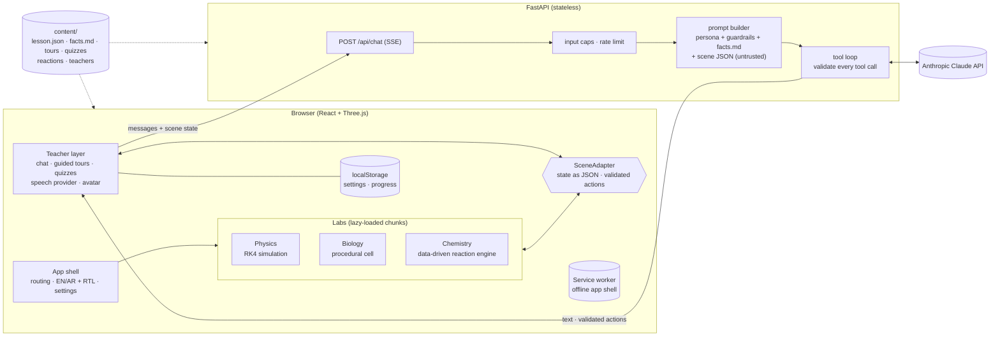
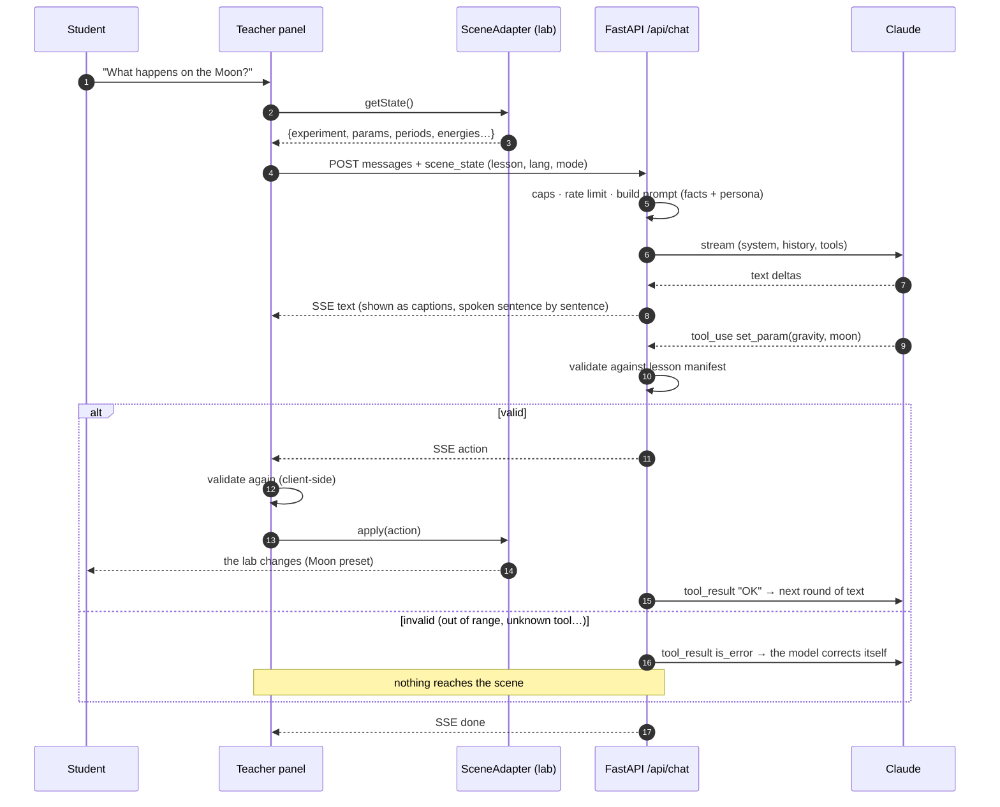

# Architecture

3D School is a **static React app** plus a **small FastAPI service whose only job is to proxy the LLM**. Everything a student
can do except talk to the AI teacher works with the API switched off.

## System



**Why this shape**
- *Keys never reach the browser*: the only network call to an LLM is server-side.
- *Content is data, shared by both halves*: `content/` is read by the frontend (bundled by Vite) and by the API (read from disk).
  The facts file the model treats as ground truth is the same material the labs are built from, and the tool ranges the model
  may use are the same ranges the sliders use.
- *The API is stateless*: the browser sends the conversation and the current scene state each time, so it scales to zero
  (Fly/Render free tiers) without losing anything.
- *Graceful degradation is a feature*: no API key, a sleeping free-tier server, or no network at all → the teacher panel says so,
  and the guided tours and quizzes (client-side, data-driven) still run. The service worker makes that work offline too.

## One teacher turn



## Key design decisions (and what they cost)

| Decision | Why | Trade-off |
|---|---|---|
| **Physics is a real fixed-step RK4 simulation** in pure TypeScript (no React/Three) | Correct science, frame-rate independent, unit-testable against textbook values | More code than an animation; the 2 ms step costs ~500 steps/s (measured: negligible) |
| **Reactions are data** (`reaction.json` + en/ar text); one generic engine plays any of them | Adding HCl + NaOH needed zero code; a validator proves every file balances and animates the right molecules | Keyframes are authored by hand, not simulated; the model is explicitly schematic |
| **Tool calls are validated twice** (server before accepting, browser before applying) with two implementations sharing one test fixture | The model's output is untrusted; the browser trusts nothing from the wire either | Two validators to keep in sync, which the shared 52-case fixture enforces |
| **Scene state sent as JSON with every request** and wrapped as *untrusted data* in the prompt | The teacher can refer to what the student actually sees ("I see you set 60°") | Larger prompts; capped at 4 KB, and kept out of the cached prefix |
| **Static persona + guardrails + facts in a cached system block**; language and mode in a small uncached block | Switching language or mode never invalidates the prompt cache | Facts must fit the prompt (they do: a few thousand tokens per lesson) |
| **Web Speech API behind a `SpeechProvider` interface** | Free, zero-config, works offline | Quality varies; **lip-sync is simulated** (no audio waveform is exposed); Arabic voices are often missing on desktop |
| **Offline tours and quizzes are client-side data** | The demo can't break: no key, no network, still works | Tour narration is fixed text, not generative |
| **Adaptive quality** (starts low only on ≤2 cores/≤2 GB, then watches real fps and downgrades) | Mid-range Android should "just work" without a settings dialog | Can't know the GPU in advance, so the first seconds on a weak device may stutter once |
| **Progress in localStorage, sanitised on load** | No accounts, no backend state, no privacy burden | Per-browser only; not shared across devices |

## Folder map

```
content/                  data only, shared by web and api
  lessons/<id>/           lesson.json (params, tool manifest), facts.md, tour*.json, quiz*.json, reactions/
  teachers/               personas, voices, looks
  elements.json           CPK colours + radii
  tests/tool-cases.json   validator cases run by BOTH test suites
web/src/
  app/ landing/ core/     shell, hallway, lesson registry, quality monitor
  labs/physics|biology|chemistry/   each: scene, UI, and a pure engine (sim/ or engine/)
  teacher/                chat store, SSE client, tools validator, tours, speech, avatar
  quiz/ store/ i18n/      quiz dialog + scoring, settings + progress, en/ar strings
web/e2e/                  Playwright audits (axe a11y, overflow, perf, screenshots)
api/app/
  routes/                 chat (SSE), health
  llm/                    prompt, tools, Anthropic client, mock, tool loop
```
